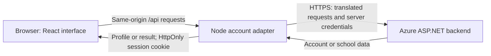

# Student Exchange developer guide

This guide is for students joining the project who have some JavaScript experience and are learning React, TypeScript, and web APIs. Start with the local setup, then follow a request through the code before making your first change.

## Contents

- [What the website does](#what-the-website-does)
- [Get running in VS Code](#get-running-in-vs-code)
- [Understand the architecture](#understand-the-architecture)
- [Find the code you need](#find-the-code-you-need)
- [Understand account requests](#understand-account-requests)
- [Sessions, secrets, and visitor IPs](#sessions-secrets-and-visitor-ips)
- [Make and test a change](#make-and-test-a-change)
- [Debug in VS Code](#debug-in-vs-code)
- [Deploy to Render](#deploy-to-render)
- [Troubleshoot common problems](#troubleshoot-common-problems)
- [Further reading](#further-reading)

## What the website does

Student Exchange is a student marketplace website. The current implementation includes:

- A responsive homepage with search and category filters over sample listings.
- Account registration, login, profile editing, session restoration, and logout.
- A school selector loaded from the deployed backend.

Listings are sample data in the repository. Creating listings, uploading photos, contacting real sellers, payments, and messaging are not implemented. The documented backend currently exposes account and school endpoints, not marketplace endpoints. Avoid presenting sample data as live inventory.

The account backend is a separate ASP.NET application hosted on Azure. Its source code and database are not in this repository. You do not need .NET installed to run this website against the deployed backend.

## Get running in VS Code

### 1. Install the tools

Install Git, Visual Studio Code, and **Node.js 24 LTS**. This repository supports Node versions `>=24.15.0` and `<25`; `.nvmrc` pins `24.19.0`. npm, the package manager used here, comes with Node. Install Google Chrome if you want to use the included browser debugger.

Check your terminal:

```sh
git --version
node --version
npm --version
```

If you use nvm on macOS or Linux, run `nvm install` and `nvm use` from the repository folder. Otherwise, install a compatible Node 24 version directly. Restart VS Code after installing Node so its terminal can find it.

### 2. Open the project

For a new checkout containing the current implementation:

```sh
git clone --branch ChatGPT https://github.com/supracharger/StudentExchange-Website.git
cd StudentExchange-Website
code .
```

If the team has merged these changes into another branch, use that branch instead. For an existing checkout, check `git status` before switching branches so you preserve your work. If `code` is unavailable, use **File → Open Folder** in VS Code.

Open **Terminal → New Terminal**. Run all npm commands from the folder containing `package.json`.

### 3. Configure the server

The following names are case-sensitive:

| Variable      | What it means                                                  | Needed for                  |
| ------------- | -------------------------------------------------------------- | --------------------------- |
| `backend`     | Base URL of the separate account API.                          | School lookup and accounts. |
| `app_access`  | Shared credential that identifies this website to the backend. | Account requests.           |
| `user` | Service account email with backend admin membership. | Account requests. |
| `user_pass` | Service account login password (server-only secret). | Account requests. |

The current backend URL is:

```text
https://studentexchangebck-fpdnfpcqe4bje2eh.westus-01.azurewebsites.net
```

Ask the project maintainer for approved access to the service account credentials and application credential through the team's secure channel. Their values are deliberately absent from this guide and `.env.example`.

Prefer supplying credentials through your development environment's secret settings. If your team permits a local credential file, create `.env.local` in the project root using `.env.example` as its template, and fill in the blank values privately. Git ignores `.env.local`; do not force-add it, share screenshots of it, or paste its contents into issues. Neither this guide nor the setup creates a credential file for you.

Both Vite and `npm start` read `.env.local`. Existing process environment variables take precedence in the Vite configuration. Restart the server whenever you change settings. Never rename a credential to `VITE_app_access` or `VITE_user` or `VITE_user_pass`: Vite's `VITE_` prefix makes variables available to browser code.

Without account credentials, you can still work on the homepage. With `backend` alone, school lookup works; account operations report that the service is unavailable. Automated tests use fake local services and do not require real credentials.

### 4. Install and start

```sh
npm ci
npm run dev
```

`npm ci` installs the exact dependency versions recorded in `package-lock.json`. It replaces `node_modules`, so do not edit dependency files inside that directory.

Open the address printed by Vite, normally `http://localhost:5173`. Keep the terminal running. Saving a frontend file refreshes the page automatically. Press **Ctrl+C** to stop the server.

Confirm that the homepage renders, search/filter controls work, and the account panel can load schools. An initial `401` response from `/api/profile` is expected when you have not logged in: the app checks whether an existing session can be restored.

Do not repeatedly register accounts on the live backend just to check startup. Registration creates persistent records. Administrator account deletion uses `DELETE /Register` with the exact target email in `to_user`; see [the administrator guide](docs/administration.md). Coordinate live test accounts with the maintainer.

## Understand the architecture

The **frontend** is the React code that runs in the browser. A React component is a function describing a part of the interface. TypeScript adds checks for data shapes and function arguments before deployment. Vite starts the development server and builds the frontend files for production.

The **adapter** is Node code that runs on the server. It translates the website's requests into the separate backend's API contract and adds credentials privately. In development, Vite installs this adapter as request-handling middleware. In production, the Node server serves both the built website and the adapter.



**Same origin** means the browser sends requests to the same scheme, hostname, and port that served its page. Browser code uses `/api/...` relative URLs instead of contacting Azure directly. This keeps shared secrets out of the browser and allows cookie-based sessions without a separate cross-origin setup.

The backend expects JSON bodies even for some GET requests. Browser `fetch` does not allow a GET body; the Node adapter can send one using Node's HTTP client. Preserve this adapter when changing account functionality.

## Find the code you need

| File or folder                           | Responsibility                                                                                               |
| ---------------------------------------- | ------------------------------------------------------------------------------------------------------------ |
| `src/main.tsx`                           | Mounts React into the HTML page.                                                                             |
| `src/App.tsx`                            | Homepage, listing search/filtering, and account entry point.                                                 |
| `src/data/listings.ts`                   | Sample listing data and its types.                                                                           |
| `src/components/AccountPanel.tsx`        | Login, registration, school selection, and profile forms.                                                    |
| `src/hooks/useAccount.ts`                | Account state, session restoration, and action feedback. A hook shares stateful behavior between components. |
| `src/api/accounts.ts`                    | Typed browser API functions, request timeouts, and error conversion.                                         |
| `src/styles.css`, `src/account.css`      | Homepage and account styling, including responsive layouts.                                                  |
| `server/api.mjs`                         | Upstream API calls, input checks, credential injection, and sessions.                                        |
| `server/client-ip.mjs`                   | Visitor IP selection and validation.                                                                         |
| `server/app.mjs`                         | Production static-file serving, API handling, and `/healthz`.                                                |
| `server/index.mjs`                       | Reads runtime settings and starts the production server.                                                     |
| `server/api.d.mts`                       | TypeScript declarations for the JavaScript adapter module.                                                   |
| `vite.config.ts`                         | Development/preview adapter wiring, ports, and test configuration.                                           |
| `src/**/*.test.tsx`, `server/*.test.mjs` | UI and server tests.                                                                                         |
| `src/test/setup.ts`                      | Shared test setup.                                                                                           |
| `.vscode/`                               | Debug configurations and build/test tasks.                                                                   |
| `render.yaml`                            | Render Web Service deployment configuration.                                                                 |
| `img/`, `public/`                        | Design references and static assets; `public/` files are copied into the build.                              |

`.tsx` files can contain TypeScript and JSX, the markup-like syntax used by React. `.mjs` files are JavaScript modules. `dist/` is generated by the build; change source files instead. `node_modules/` contains installed dependencies. Neither generated folder belongs in a commit.

## Understand account requests

HTTP methods describe the operation: GET reads data, POST submits an action or creates data, PATCH changes selected fields, and DELETE removes or revokes something. JSON is the structured data format used in request and response bodies.

| Browser request      | Adapter's upstream request              | Important behavior                                                        |
| -------------------- | --------------------------------------- | ------------------------------------------------------------------------- |
| `GET /api/schools`   | `GET /Schools`                          | Maps lowercase `schools`; forwards the visitor IP and configured server credentials. |
| `POST /api/register` | `POST /Register`                        | Creates an account; the user must then log in separately.                 |
| `POST /api/login`    | `POST /LogIn`, then `GET /Register`     | Retrieves a backend token and profile, then creates the website session.  |
| `GET /api/profile`   | `GET /Register` with JSON body          | Reads the profile using the token held by the server.                     |
| `PATCH /api/profile` | `PATCH /Register`, then `GET /Register` | Sends changes and reads the normalized profile back.                      |
| `POST /api/logout`   | `DELETE /LogIn`                         | Revokes the user's backend tokens and clears the website session.         |

Registration fields are `email`, `first_name`, `last_name`, `school`, and `password`. Registration requires a matching Confirm Password entry. Profile editing requires confirmation only when a new password is entered. Confirmation is checked in the interface and is never sent to the backend. The public profile excludes the password. Profile updates send only changed fields; an empty optional password is omitted.

For example, a name change moves through `AccountPanel.tsx` → `useAccount.ts` → `accounts.update()` in `src/api/accounts.ts` → `/api/profile` in `server/api.mjs` → Azure. If the PATCH succeeds but its follow-up read fails, the adapter reports that the save succeeded and a refresh is needed. The hook keeps the previous displayed profile. Do not automatically repeat the write, especially a password change.

When adding an API feature, first confirm that the backend supports it in [the backend reference](readme-Backend_Info.md). Then update the browser types, adapter route and validation, UI, and relevant tests. Keep the adapter's permitted fields explicit; browser input must not control credentials or the upstream destination.

## Sessions, secrets, and visitor IPs

After login, the browser gets an opaque `se_session` cookie: a random identifier rather than the Azure token. The Node process stores the corresponding token in memory. The cookie is **HttpOnly**, so browser JavaScript cannot read it, and **SameSite=Lax**, which restricts when it accompanies cross-site requests. In production it is also **Secure**, so it travels over HTTPS.

Sessions last up to 12 hours; backend expiry may invalidate them sooner. Restarting or redeploying the Node server loses its in-memory sessions and logs users out. Run one Render instance until a shared session store is implemented. Logout revokes all backend tokens for that user, including sessions on other devices.

The server logs in to `POST /LogIn` at startup using server-only `user` (sent as `email`), `user_pass` (sent as `password`), and `app_access`, without forwarding fields. It verifies admin membership via an unforwarded `GET /Admin`, caches the returned access token in server memory, and uses it as `admin_token` for visitor requests. An HTTP 400 response with `expired: true` triggers one shared re-login and one retry of the original request. Ordinary visitor-token expiry never triggers service login. No password is sent as `admin_token`.

Every visitor upstream account request includes server-generated `app_access`, `admin_token`, and `ip` in its JSON body, including profile GET requests. The public `/Schools` request also carries the trusted visitor IP; its current parameterless backend controller does not consume it. The application credential, service account credentials, and Azure tokens must never be returned to the browser or placed in browser storage. User passwords necessarily pass through the login/registration form, but are not retained in browser storage or server sessions. Do not log request bodies, cookies, passwords, or tokens while debugging.

Visitor IP selection depends on where the server runs:

| Environment               | IP source                                                                                                       | Reason                                                                 |
| ------------------------- | --------------------------------------------------------------------------------------------------------------- | ---------------------------------------------------------------------- |
| Local Vite or local Node  | Socket peer address, normally `127.0.0.1` or `::1`.                                                             | Local clients cannot choose a trusted forwarding header.               |
| Production Node on Render | Validated `CF-Connecting-IP` from Render's public Cloudflare edge, selected when Render supplies `RENDER=true`. | The socket peer is a proxy; this header represents the public visitor. |

The adapter ignores `X-Forwarded-For`. In Render mode, absent or malformed visitor IP headers cause an account request to fail rather than forwarding an incorrect address. Do not set `RENDER=true` locally or expose an untrusted route that bypasses Render's public edge. This mode assumes that edge is the trusted source; private-network callers must also be trusted. A visitor behind a VPN or shared network is represented by that network's public IP.

The backend accepts forwarding when `admin_token` is valid. Its documented application authorization checks the adapter connection's IP before body forwarding, so forwarding does not bypass that earlier check. The adapter also checks the Origin header on state-changing requests, limits payload sizes, applies timeouts, and masks upstream exception details. Preserve these checks when extending it.

## Make and test a change

Start with a small change, such as adjusting an account label or improving a mobile layout. Explain why a decision matters in comments, especially around backend behavior and security; avoid comments that merely repeat the next line of code.

1. Start from the team's current implementation branch and create a feature branch, such as `git switch -c feature/account-label`.
2. Run the website and locate the relevant file using the project map.
3. Make the change and check loading, success, and error states. For layout changes, also use the browser's narrow-screen view.
4. Run the checks appropriate to the change. For application code, use `npm test` and `npm run build` before requesting review.
5. Inspect `git diff` and `git status`; stage specific files, commit, push your feature branch, and open a pull request. Explain the change and how you verified it. Follow the team's review process before merging.

| Command              | Purpose                                                                     |
| -------------------- | --------------------------------------------------------------------------- |
| `npm run dev`        | Frontend development and account adapter on port 5173.                      |
| `npm run typecheck`  | Checks TypeScript without creating a build.                                 |
| `npm test`           | Runs automated UI and server tests once.                                    |
| `npm run test:watch` | Keeps tests running while you edit.                                         |
| `npm run build`      | Checks types and creates production frontend files in `dist/`.              |
| `npm run preview`    | Serves an existing build with the adapter on port 4173.                     |
| `npm start`          | Serves an existing build and the adapter with Node on port 3000, or `PORT`. |

Run `npm run build` before preview or start. Preview is a local inspection tool; Render uses `npm start`.

Vitest is the test runner. React Testing Library exercises the interface through user-visible controls. Server tests use disposable local HTTP fixtures: small fake backends with synthetic credentials. They can test failures and forwarding rules without creating live accounts. A passing fixture test does not prove that a deployed backend's credentials are valid.

The current automated suite has 43 passing offline tests and a successful production build. Live Azure account workflows also passed. See [the validation report](docs/live-validation.md) for scope. Actual visitor IP attribution through a deployed Render service still needs a deployment check.

### Live integration tests and account cleanup

Routine `npm test` uses local fixtures, not Azure. Any successful registration in the server fixtures is tracked and removed in `afterEach`, including when an assertion fails. UI tests mock account calls and create no database records.

To run the real Azure registration/login/deletion test, supply `backend`, `app_access`, `user`, `user_pass`, and the server-only secrets `sudo_user` and `sudo_pass` through your environment. The sudo username is sent as the login `email`; `sudo_pass` is sent as `password`. Do not add these privileged credentials to browser code or Render's normal website settings: they are needed only by the live test runner.

On macOS/Linux or a bash terminal:

```sh
RUN_LIVE_API_TESTS=1 npm test -- server/live.test.mjs
```

In PowerShell, set `$env:RUN_LIVE_API_TESTS = "1"`, run `npm test -- server/live.test.mjs`, then remove the flag with `Remove-Item Env:RUN_LIVE_API_TESTS`.

Run this live test only after the backend `to_user` deletion update is deployed. The live test authenticates sudo before registration, creates a unique `codex.live.*@example.com` account, and runs `DELETE /Register` in `finally`. Deletion sends `app_access`, the sudo `access_token`, and the target email in `to_user`, plus the normal `admin_token`/`ip` forwarding fields. A final login attempt verifies the deleted account cannot authenticate. Cleanup failures fail the test and report the generated email for repair; they are never silently ignored. If the process is forcibly killed or the backend is unreachable, `finally` cannot guarantee deletion, so the backend maintainer must remove the leftover test record.

`server/test-account-cleanup.mjs` limits targets to designated `codex.test`, `codex.browser`, `codex.forward`, and `codex.live` addresses under `example.com`. It exposes no browser route. It does not log out sudo because backend logout revokes every session belonging to that shared administrator. The short-lived token remains only in runner memory and expires under backend policy.

When intentionally adding a dependency, use npm so both `package.json` and `package-lock.json` are updated, review the changes, and commit both. Use `npm ci` for routine installation.

## Debug in VS Code

For frontend breakpoints, stop any manually started Vite instance, open **Run and Debug**, choose **Debug Student Exchange in Chrome**, and press **F5**. Its background task starts Vite automatically. Place a breakpoint in a component or API function and trigger the relevant UI action. Stop the background server through **Tasks: Terminate Task** when finished.

For server breakpoints, choose **Debug Student Exchange Node server**. It builds the frontend and runs `server/index.mjs` on port 3000, reading `.env.local` if present. Open `http://localhost:3000` and set breakpoints in `server/api.mjs`. The Chrome configuration starts Vite and does not attach the Node debugger to its adapter.

In browser developer tools, use **Console** for frontend errors and **Network** for `/api` status codes and timing. Avoid sharing screenshots or exporting network traces containing passwords or session cookies. Inspect request paths, status codes, and sanitized messages first.

## Deploy to Render

Create a **Node Web Service**, using the repository's `render.yaml` as a Blueprint or entering the equivalent settings manually. The Node adapter requires a running server.

| Setting        | Value                                                                                |
| -------------- | ------------------------------------------------------------------------------------ |
| Repository     | `supracharger/StudentExchange-Website`                                               |
| Branch         | `ChatGPT` until the implementation is merged; then use the team's deployment branch. |
| Root directory | Leave blank.                                                                         |
| Build command  | `npm ci --include=dev && npm run build`                                              |
| Start command  | `npm start`                                                                          |
| Health check   | `/healthz`                                                                           |
| Node version   | `NODE_VERSION=24.19.0`                                                               |
| Runtime mode   | `NODE_ENV=production`                                                                |
| Backend URL    | `backend` set to the Azure URL above.                                                |
| Credentials    | Enter `app_access`, `user`, and `user_pass` in Render's environment settings.               |
| Instances      | One until sessions use a shared store.                                               |

The build explicitly includes development dependencies because TypeScript, Vite, and React type declarations are needed during compilation, even with `NODE_ENV=production`. Keep production mode enabled for the running server.

Render provides `PORT` and the `RENDER=true` flag automatically. Do not put credential values in `render.yaml`. Redeploy/restart after changing environment settings.

After deployment, check the HTTPS homepage and `/healthz`, load schools, and use an approved test account to verify login, profile retrieval, and logout. `/healthz` reports process health and configuration presence, not whether Azure accepts the credentials. Coordinate with the backend maintainer to confirm that a request through the public Render URL is attributed to the visitor's public IP. Check that built assets load and browser errors are absent. Do not log shared credentials to diagnose attribution.

## Troubleshoot common problems

| Symptom                                             | What to check                                                                                                                               |
| --------------------------------------------------- | ------------------------------------------------------------------------------------------------------------------------------------------- |
| `node` or `npm` is not recognized.                  | Install compatible Node 24 and restart the VS Code terminal.                                                                                |
| npm cannot find `package.json`.                     | Open the repository root and run commands from that folder.                                                                                 |
| Install/build reports an unsupported engine.        | Check `node --version`; use the project's supported Node 24 range.                                                                          |
| Port 5173 or 4173 is already in use.                | Stop the earlier server you started. These Vite ports are fixed; F5 may have started a background task.                                     |
| Account service unavailable (`503`).                | Check all four server settings, exact spelling, and whether you restarted after changes. Check connectivity; do not print secret values.   |
| School lookup fails.                                | Check `backend`, network access, and Azure availability. School lookup does not need account secrets.                                       |
| `/api/profile` returns `401` before login.          | Normal session-restoration behavior. Log in to obtain a session.                                                                            |
| Logged out after restarting or redeploying.         | Expected with the current in-memory session store.                                                                                          |
| Login/session fails over local HTTP.                | Leave `NODE_ENV=production` unset locally so the cookie is not Secure-only. Use HTTPS in production.                                        |
| An account action returns `403`.                    | Inspect the sanitized message: verify the page and API share an origin and that backend authorization is configured correctly.              |
| Unable to verify network address (`400`) on Render. | Check the public edge path and visitor header behavior with the maintainer. Do not bypass validation or trust arbitrary forwarding headers. |
| `npm start` says to build first.                    | Run `npm run build`; the Node server serves files from `dist/`.                                                                             |
| Source edits do not appear with `npm start`.        | Rebuild the frontend. Use `npm run dev` for automatic frontend updates. Restart after server/config changes.                                |
| Account update saved, but profile refresh failed.   | Refresh the profile after the connection recovers; do not blindly repeat a password write.                                                  |

When asking a teammate for help, include the command or action, Node version, sanitized error/status, and relevant file. Keep credentials, passwords, cookies, and tokens out of the report.

## Further reading

- [Repository overview](readme.md)
- [Backend API reference](readme-Backend_Info.md)
- [Recorded live verification](docs/live-validation.md)
- [React: learn components and state](https://react.dev/learn)
- [TypeScript handbook](https://www.typescriptlang.org/docs/handbook/intro.html)
- [Vite guide](https://vite.dev/guide/)
- [Vitest guide](https://vitest.dev/guide/)
- [Render environment variables](https://render.com/docs/environment-variables)
