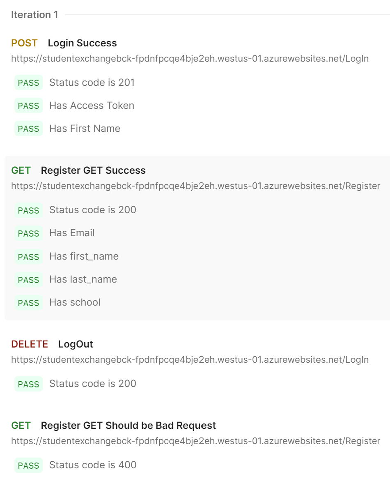
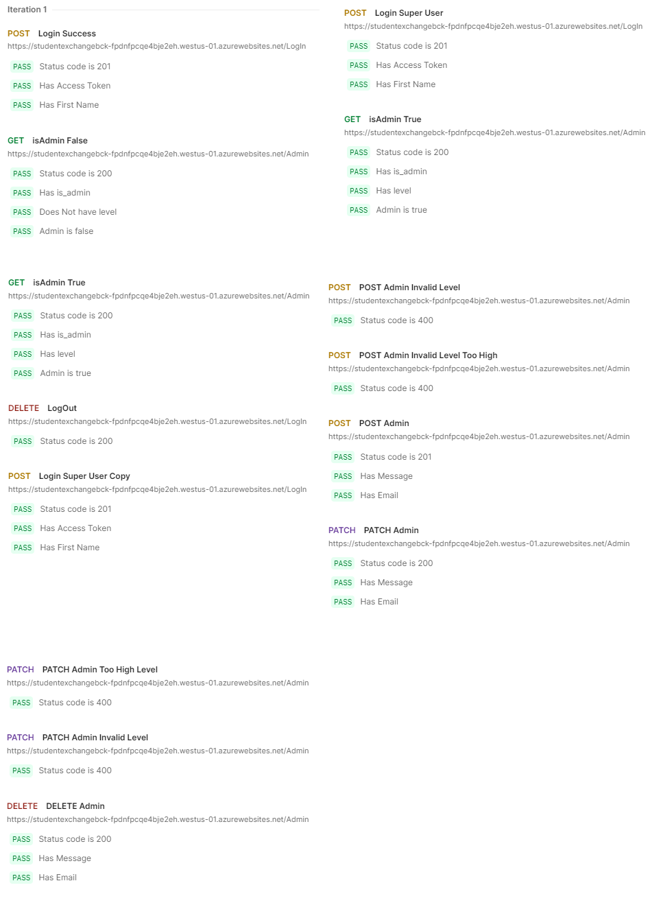
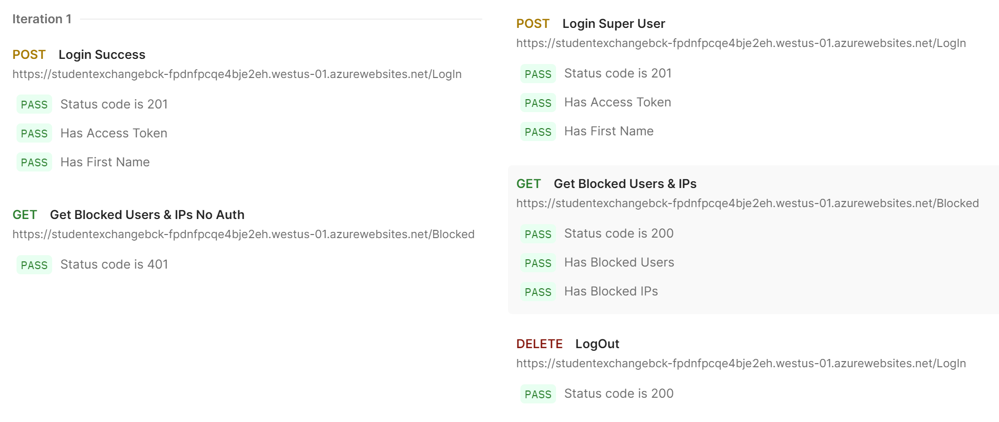
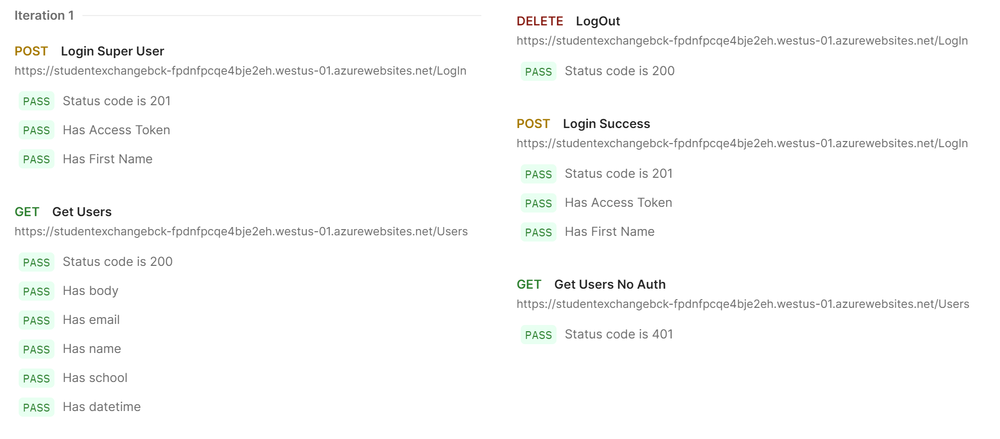
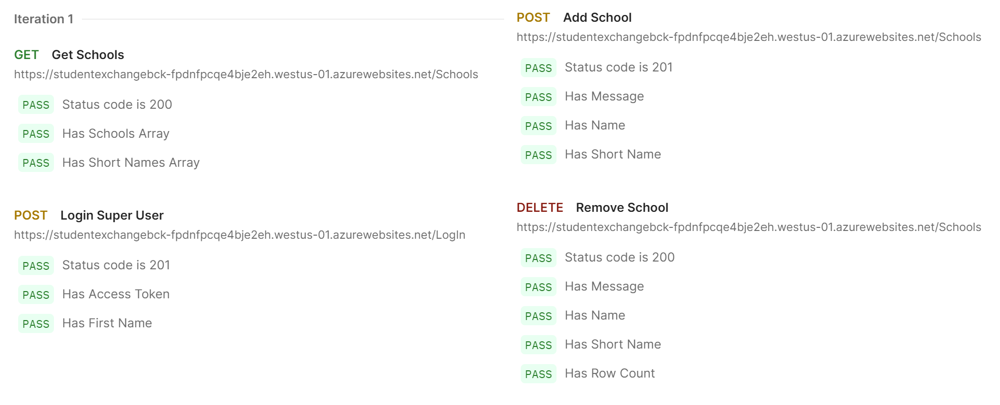
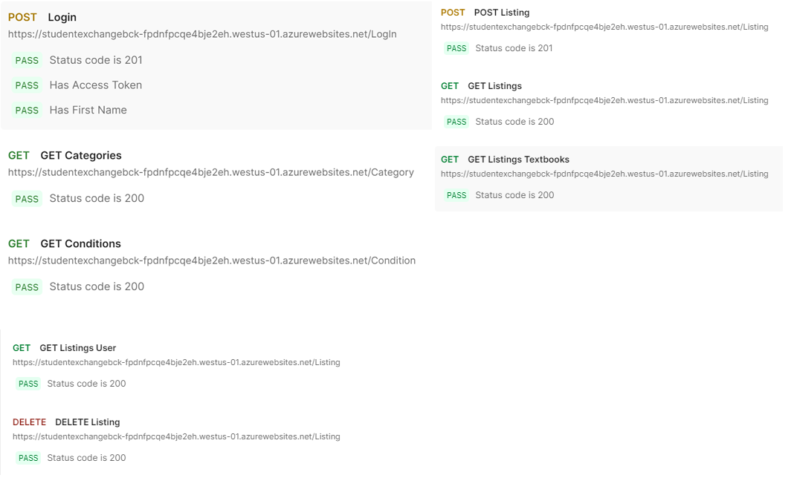

# Backend Test Evidence

## Register Postman Tests

## Login Postman Tests

## Logout Postman Test

***NOTE!:*** There is no longer a link to a Postman collection without subscription.

## Admin Postman Tests

## Blocked Postman Tests

## Users Postman Tests

## Schools Postman Tests

## Listings Postman Tests

